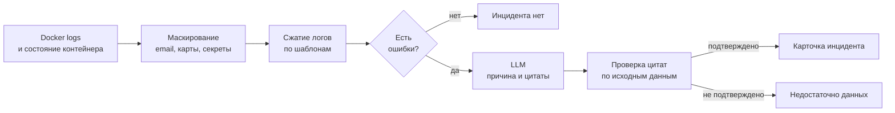

# AI SRE prototype

Агент, который разбирает сбой контейнерного сервиса и возвращает карточку инцидента: что сломалось, вероятная причина, что сделать и на каких строках логов основан вывод.

Работает с локальной LLM через OpenAI-совместимый API. Логи не покидают ваш контур.

## Как это работает



Модель не получает доступа к Docker. Каждое утверждение должно ссылаться на конкретное наблюдение и содержать точную цитату из него, иначе оно помечается как неподтверждённое.

## Запуск

Нужны Docker, uv и LLM-сервер с OpenAI-совместимым API, например `llama-server` на порту 8080.

```bash
docker compose --env-file scenarios/bad_release.env up --build --exit-code-from agent
docker compose down
```

Карточка появится в `reports/bad_release.md`. Другой адрес модели задаётся через `LLM_URL`.

| Сценарий | Что сломано |
|---|---|
| `bad_release` | релиз падает на заказах без промокода |
| `bad_config` | слишком маленький таймаут платёжного шлюза |
| `pool_leak` | релиз не возвращает соединения в пул |
| `healthy` | сбоя нет |

Прогон всех сценариев и сравнение с запросом к LLM по сырым логам:

```bash
uv run evaluation/run.py
```

## Пример карточки

```text
Статус: Причина найдена
Категория: bad_release

Вероятная причина:
В total_with_required_promo (pricing.py, строка 7) обращение к None вызывает TypeError.

Рекомендуемое действие:
Откатить версию до 2.3.1 или обработать заказы без промокода.

Доказательства:
✓ L1 x244: order failed ... pricing.py, line 7 ... TypeError: 'NoneType' object is not subscriptable
✓ F1: container status=running restarts=0 oom_killed=False
```

## Структура

```text
agent/
  collectors/   сбор логов и состояния контейнера
  processing/   маскирование, шаблоны, наблюдения
  llm/          клиент модели
  analysis/     расследование и проверка выводов
  report/       карточка инцидента
services/
  shop/         демо-сервис с багами в релизах
  load/         генератор заказов
scenarios/      конфигурации сбоев
evaluation/     прогон сценариев
```
